# SETU — The AI-Powered Adaptive Learning Platform

[](https://github.com/Leeladhar-Kaluru/SETU-Adaptive-Learning-Platform)
[](https://react.dev)
[](https://fastapi.tiangolo.com)
[](https://supabase.com)
[](https://web.dev/progressive-web-apps/)

> **SETU** (*Sanskrit for "Bridge"*) transforms static, monolithic school textbooks and curriculum documents into interactive, personalized, and offline-capable learning journeys. Combining deterministic Table of Contents parsing, local-first AI vector retrieval (pgvector 768d), real-time adaptive concept mastery, and a durable zero-terminal background queue, SETU bridges educational inequity for school students everywhere.

---

## 🌟 Executive Summary & Core Innovations

Traditional digital education tools rely on static PDFs, fragmented question banks, or ungrounded chatbots prone to hallucinations. **SETU** takes a fundamentally different, source-grounded approach:

1. **100% Real Source Grounding — Zero Fabricated Data**:
   Every learning plan, chapter sequence, lesson block, question, and citation is parsed deterministically from real uploaded publisher textbooks (e.g. NCERT 172-page Class 10 *First Flight*). No mock database seeds or fabricated analytics exist in production flows.
2. **Authoritative Table of Contents & Index Parsing Engine**:
   Rather than guessing section breaks with arbitrary regex, SETU inspects front matter pages, decodes font-shifted publisher indices (such as Caesar-shifted `)UTZKTZY`), maps physical-to-printed page coordinates, and contiguously structures all 11 chapters from page 11 to 172 without missing a single topic.
3. **High-Yield Question Synthesis**:
   Enforces $\ge 5$ multiple-choice questions per checkpoint test and 3–5 practice MCQs with progressive hints. Every question is complete with 4 verified options, deterministic answer keys, and pedagogical feedback formatted in clean Unicode ($82^\circ30'\text{ E}$, $\text{H}_2\text{O}$, $\text{x}^2 + \text{y}^2$), completely free of raw LaTeX syntax errors.
4. **Dynamic Bayesian Mastery & Adaptive Remediation**:
   Tracks conceptual proficiency across concept IDs. When a learner struggles on a checkpoint test (e.g., scoring in the `developing` band), the platform automatically injects a tailored refresher lesson (`Foundations & Guided Refresher: {Chapter Title}`) into their learning path, shifting downstream lessons by $+1$ to resolve learning gaps before advancing.
5. **Ask SETU — Hybrid Semantic Grounded Companion**:
   Hybrid retrieval fusing **768-dimensional dense vector embeddings** (`nomic-embed-text-v1.5`) with **PostgreSQL Full-Text Search** (`tsvector` via Reciprocal Rank Fusion). Every doubt response cites exact textbook pages (`pageStart`, `pageEnd`) with verified excerpts.
6. **Embedded Zero-Terminal Background Pipeline**:
   Long-running document extraction, chunking, embedding, and lesson generation run inside an asynchronous background loop within FastAPI's lifespan using PostgreSQL row-level locks (`FOR UPDATE SKIP LOCKED`). Database sessions are decoupled during AI generation to eliminate connection pool starvation.
7. **Offline-First PWA (IndexedDB + Background Sync)**:
   Equipped with Service Workers and IndexedDB (Dexie.js). Students can save entire lesson packages offline, read content, answer quizzes, and queue doubts in remote or low-connectivity environments. Everything syncs idempotently upon reconnection.

---

## 🏗️ System Architecture

```mermaid
flowchart TD
    subgraph Client ["Frontend: The Learning Desk (React 19 + TypeScript + Vite + PWA)"]
        UI["The Learning Desk UI\n(CSS Modules + Design Tokens)"]
        DexieDB["Local-First Offline Storage\n(IndexedDB via Dexie.js)"]
        Reader["Interactive Lesson Reader\n(Visuals, Worked Examples, Practice)"]
        QuizUI["Adaptive Checkpoint Quizzes\n(>= 5 MCQs + Progressive Hints)"]
        Chatbot["Ask SETU Drawer\n(Page-Grounded Doubt Resolution)"]
    end

    subgraph Backend ["Backend: High-Throughput Async Core (FastAPI + Python 3.11)"]
        API["REST Endpoints\n(/auth, /documents, /learning-paths, /study)"]
        Pipeline["Embedded Background Pipeline\n(PostgreSQL Row Locks + Atomic Leases)"]
        TOCEngine["TOC & Layout Engine\n(PyMuPDF + Caesar Index Decoder)"]
        AdaptiveEngine["Adaptive Mastery Engine\n(Real-Time Mastery Bands & Dynamic Rerouting)"]
        RAGService["Hybrid Retrieval Engine\n(pgvector 768d + Reciprocal Rank Fusion)"]
    end

    subgraph AI ["AI & Embedding Tier (Local-First Inference)"]
        LocalAI["Local Inference Gateway\n(127.0.0.1:1234/v1)"]
        LLM["google/gemma-4-e4b\n(Pedagogical Synthesis & Tutoring)"]
        Embedder["nomic-embed-text-v1.5\n(768-dim Dense Vector Embeddings)"]
    end

    subgraph DataTier ["Data Tier (Supabase PostgreSQL 17 + Storage)"]
        PG["PostgreSQL 17 Database\n(Port 5432 Session Mode)"]
        PGVector["pgvector Extension\n(768d Cosine Distance <=>)"]
        Tables["Relational Schema\n(documents, pages, chunks, paths, lessons, questions, attempts, doubts)"]
        S3Bucket["Supabase Private Storage\n('setu-documents' Bucket)"]
    end

    UI --> API
    UI <--> DexieDB
    API --> Tables
    Pipeline --> Tables
    Pipeline --> S3Bucket
    TOCEngine --> Pipeline
    Pipeline --> LLM
    Pipeline --> Embedder
    RAGService --> PGVector
    RAGService --> Embedder
    AdaptiveEngine --> Tables
```



---

## ⚙️ How It Works: Deep Dive

### 1. Document Ingestion & Authoritative Table of Contents Engine
* **PyMuPDF Extraction**: Extracts full text, bounding boxes, and structure across all pages within seconds, sanitizing control characters and null bytes (`\x00`).
* **Caesar Font-Shift Decoding**: Automatically detects non-standard font encoding in publisher front matter (e.g. NCERT's Caesar-shifted `)UTZKTZY` for `CONTENTS`) and normalizes it to clean text.
* **Coordinate Synchronization**: Maps physical PDF page indexes to printed textbook page numbers ($P_{\text{PDF}} = P_{\text{print}} + \text{offset}$), guaranteeing contiguous, non-overlapping chapter boundaries from Chapter 1 to the final unit.
* **Semantic Chunking & Dense Embeddings**: Partitions text into overlapping 500–800 character chunks with preserved heading paths (`["Chapter 1: A Letter to God", "The Hailstorm"]`). Each chunk is embedded into a 768-dimensional dense vector using `nomic-embed-text-v1.5` and stored in PostgreSQL with `pgvector`.

### 2. Embedded Zero-Terminal Background Pipeline
* **Native Lifespan Worker**: Operates directly inside the FastAPI lifespan loop without requiring Celery, Redis, or external supervisor processes.
* **Atomic Leases (`FOR UPDATE SKIP LOCKED`)**: Enforces reliable PostgreSQL-backed job queues. If a server process abruptly restarts, unrenewed leases expire and are automatically recovered by the next loop cycle.
* **Connection Pool Decoupling**: Database connections are explicitly returned to the pool before issuing async AI generation calls (which take 20–30s), completely preventing connection starvation and eliminating client-side timeouts.

### 3. Dynamic Lesson Packages & Interactive Visuals
* **Typed & Versioned Lesson Packages**: Every generated chapter produces a strictly validated JSON package complying with `lesson-package.schema.json`:
  * **Learning Objectives**: Actionable pedagogical goals.
  * **Structured Content Blocks**: Conceptual explanations and summaries with direct source references.
  * **Interactive Visuals**: Educational concept maps with typed nodes and directed relational edges.
  * **Worked Examples**: Step-by-step problem-solving walkthroughs.
  * **Practice MCQs**: 3–5 interactive questions with progressive multi-tier hints.
  * **Checkpoint Test**: $\ge 5$ multiple-choice questions covering core chapter competencies.

### 4. Adaptive Mastery & Automated Remediation Loop
* **Bayesian-Inspired Concept Bands**: Tracks concept performance across all attempts:
  * `mastered`: High accuracy, zero hint reliance.
  * `practicing`: Solid understanding with minor guidance.
  * `developing`: Foundational gaps or repeated errors.
* **Remediation Injection**: If a student struggles on a checkpoint test (scoring in the `developing` band), the backend dynamically creates and injects a guided refresher lesson immediately after the checkpoint, shifts subsequent chapter sequences, and generates fresh practice problems to rebuild understanding.

### 5. Grounded AI Companion ("Ask SETU")
* **Reciprocal Rank Fusion (RRF)**: Merges dense vector similarity search (`<=>`) with PostgreSQL Full-Text Search (`tsvector`) to achieve high recall and exact keyword precision.
* **Strict Source Grounding**: Every doubt answer is extracted from the student's active textbook material. The response includes clickable citations to the exact physical pages (`pageStart`, `pageEnd`).
* **Active Book Context Awareness**: Ask SETU automatically detects which textbook and chapter the student is studying on their desk, eliminating the need to re-attach or re-explain document context.

---

## 🛠️ Technology Stack

| Layer | Technologies Used | Purpose |
| :--- | :--- | :--- |
| **Frontend Framework** | React 19, TypeScript, Vite | Modern, high-performance reactive user interface |
| **Styling & Design** | CSS Modules, Custom CSS Variables | "The Learning Desk" design system (accessible contrast, zero template defaults) |
| **Offline Architecture** | Progressive Web App (PWA), Service Workers, Dexie.js (IndexedDB) | 100% offline study, quiz attempts, and background outbox sync |
| **Backend Core** | FastAPI, Python 3.11+, SQLAlchemy 2.0, Alembic | Async REST API and embedded queue processing |
| **Database & Vector** | Supabase PostgreSQL 17, `pgvector` (768 dimensions), PostgreSQL Full-Text Search | Relational persistence and hybrid semantic retrieval |
| **Cloud Storage** | Supabase Private Storage (`setu-documents` bucket) | Encrypted storage for source PDFs |
| **Local AI Inference** | LM Studio / Local OpenAI API (`google/gemma-4-e4b`, `nomic-embed-text-v1.5`) | Private, zero-cost, local-first LLM and vector embedding inference |

---

## 📂 Project Directory Structure

```
setu/
├── backend/
│   ├── alembic/                      # Database migrations
│   ├── app/
│   │   ├── api/v1/                   # REST endpoints (auth, documents, learning_paths, study, doubts)
│   │   ├── core/                     # Configuration, database engine, AI provider, security
│   │   ├── models/                   # SQLAlchemy declarative models (documents, learning, profiles, doubts)
│   │   ├── schemas/                  # Pydantic validation schemas
│   │   └── services/                 # Core business services:
│   │       ├── adaptive_engine.py    # Concept mastery scoring & analysis
│   │       ├── attempt_service.py    # Quiz grading & dynamic remediation injection
│   │       ├── chunking.py           # Semantic text partitioner
│   │       ├── extraction.py         # PyMuPDF text & structure extractor
│   │       ├── ingestion.py          # Document indexing pipeline
│   │       ├── lesson_generator.py   # Authoritative TOC parser & lesson generator
│   │       ├── pipeline_runner.py    # Embedded PostgreSQL durable queue worker
│   │       ├── retrieval.py          # Hybrid semantic vector + FTS search
│   │       └── sync_service.py       # Ask SETU doubt grounding & citation resolver
│   └── scripts/                      # Automated verification suites & setup scripts
├── frontend/
│   ├── src/
│   │   ├── components/               # AskSetu drawer, Navigation, ConceptMap, ErrorBoundary
│   │   ├── pages/                    # HomePage (Desk), LessonReaderPage, DoubtQueuePage
│   │   ├── services/                 # API client, Dexie IndexedDB manager, SyncManager
│   │   └── styles/                   # Design system tokens and layout modules
└── context/                          # Audit verification reports & empirical evidence
```

---

## 🚀 Running SETU Locally

### Prerequisites
- **Python 3.11+**
- **Node.js 20+**
- **LM Studio** (or an OpenAI-compatible local AI server running on `http://127.0.0.1:1234`):
  * **Chat Model**: `google/gemma-4-e4b`
  * **Embedding Model**: `text-embedding-nomic-embed-text-v1.5` (768 dimensions)

### 1. Backend Setup
```bash
cd backend
python -m venv .venv
.\.venv\Scripts\Activate.ps1
pip install -r requirements.txt

# Start the FastAPI server (Embedded background worker automatically initializes)
uvicorn app.main:app --host 127.0.0.1 --port 8001 --reload
```

### 2. Frontend Setup
```bash
cd frontend
npm install
npm run dev
# The Learning Desk UI is accessible at http://localhost:5173
```

---

## 🔒 Security, Integrity & Compliance
- **Zero Secret Exposure**: Secret API keys and service-role tokens are strictly isolated to backend environments and never leaked to the client bundle.
- **Strict Data Isolation**: Student documents and learning records remain private to the user; permissions are validated on every database query.
- **Deterministic Server-Side Validation**: All quiz answers and mastery calculations are evaluated deterministically on the server to prevent client-side score manipulation.
