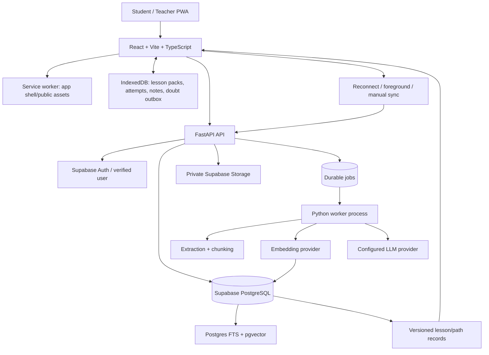

# Target Architecture

## Overview

## Deployment boundaries

- Browser never receives a hosted LLM key or Supabase service/secret key.
- FastAPI authenticates, authorises each request and returns only allowed records. RLS is a second boundary, not a substitute for API checks.
- Original student files live in private Supabase Storage. PostgreSQL stores metadata, extraction state, chunks/embeddings, learning records and queue state.
- API enqueues work; it does not block while generating a whole course.
- A worker process handles durable jobs and can restart safely.
- LLM/embedder providers are adapters: local development and hosted deployment may differ without changing lesson domain code.
- Service worker caches versioned public static assets; personalised data is scoped in IndexedDB. Do not cache every private API response globally.

## Recommended baseline stack

### Frontend
- React + Vite + TypeScript.
- CSS Modules and custom design tokens; no Tailwind v4/shadcn.
- Maintained Vite-compatible PWA/service-worker setup (e.g. Workbox integration after version check).
- IndexedDB via Dexie or a justified equivalent.
- Browser schema validation and Playwright tests for upload/lesson/offline/sync.

### Backend
- Python + FastAPI + Pydantic contracts.
- One consistent SQLAlchemy/Alembic or equivalent migration strategy; no hidden schema edits.
- Separate worker entry point.
- PDF/page extraction and `python-docx` / `python-pptx` where applicable; OCR optional and explicitly surfaced.
- Deterministic grading for supported objective questions.

### Data/storage
- Supabase Auth + PostgreSQL.
- `pgvector` plus Postgres full-text search.
- Private Supabase Storage for originals and permitted assets.
- Postgres-backed durable job table/queue initially.
- No extra vector DB, Redis or message queue until a benchmark/operational issue justifies one.

## Provider interface

A `ModelProvider` interface exposes `health_check()`, `generate_structured(task, schema, context, limits)`, `answer_grounded(question, evidence, language, limits)`, `embed(texts, model_id)`, timeouts and safe error types. Provider/model IDs are configuration, never hard-coded. A local LM Studio URL bound to a developer's machine is not automatically available to a deployed worker. For hosted generation, the deployment must have a reachable configured model provider.

## Observability

Every upload/indexing query/lesson job/doubt gets a correlation ID. Record event/status, duration, safe error category, job state and token/usage metadata where available. Never log keys, signed URLs, full documents or unnecessary sensitive learner content. Provide role-gated readiness checks for DB, storage, embedder, LLM and worker.

## Scale only after evidence

Add HNSW only after retrieval tests; separate queue only when Postgres jobs are insufficient; OCR workers when demand/privacy/cost is understood; CDN or extra object storage after storage/egress benchmarking. Cache public catalogue metadata, never private learner state across users.
